<p align="center">
  
</p>

<h1 align="center">RYFT</h1>

<p align="center"><strong>One Terminal. Every System.</strong><br />Desktop-App für SSH, SFTP, Tunnel, lokale Terminals, Docker und WSL.</p>

<p align="center">
  <a href="https://github.com/naice/ryft/actions/workflows/release.yml"></a>
  
  
  
  <a href="LICENSE"></a>
</p>

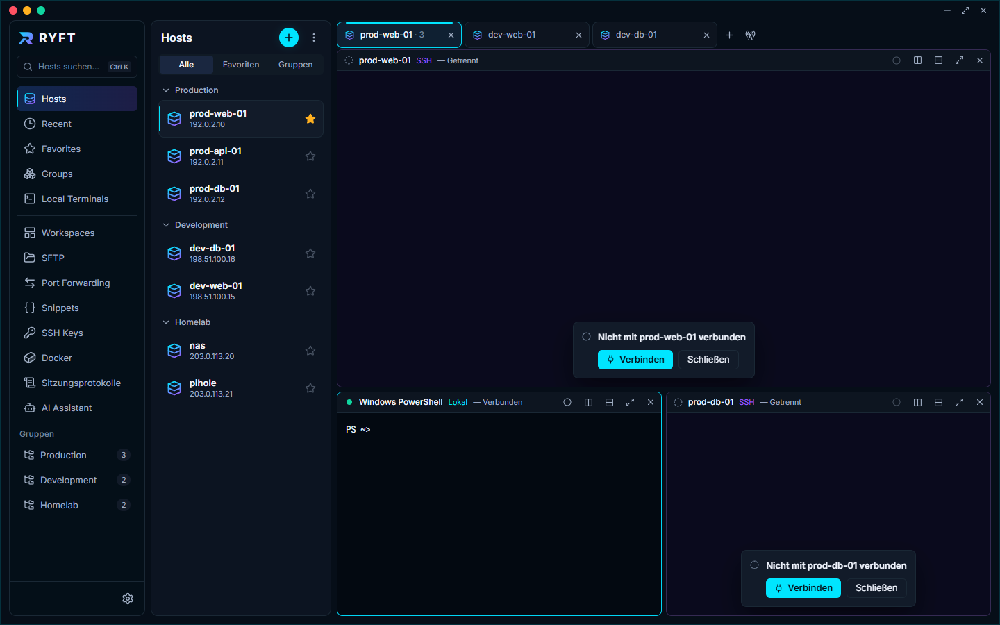

<p align="center"><em>Hostliste nach Gruppen, Tabs und frei teilbare Bereiche: oben eine SSH-Sitzung, unten eine lokale PowerShell und ein zweiter Server nebeneinander.</em></p>

## Inhalt

- [Funktionen](#funktionen)
- [Screenshots](#screenshots)
- [Installation](#installation)
- [Entwicklung](#entwicklung)
- [Tastaturkürzel](#tastaturkürzel)
- [Sicherheitsmodell](#sicherheitsmodell)
- [Fehlerbehebung](#fehlerbehebung)
- [Plattformen](#plattformen)
- [Aufbau](#aufbau)
- [Mitarbeit](#mitarbeit)
- [Lizenz](#lizenz)

## Funktionen

Die Bedienung erklärt das [Benutzerhandbuch](docs/USER_GUIDE.md).

**Hosts und SSH**

- Hosts mit Gruppen, Tags und Favoriten, dazu Ansichten für zuletzt verwendete Hosts und Favoriten
- Anmeldung per Agent, Schlüsseldatei (auch mit Passphrase), Passwort und Keyboard-Interactive
- Wiederverwendbare Anmeldeprofile und erweiterte Optionen wie Proxy, Keepalive und Umgebungsvariablen
- Host-Key-Prüfung mit Fingerprint; ein geänderter Schlüssel blockiert die Verbindung, bis du ihn bewusst ersetzt
- Sprunghosts über mehrere Stationen, mit eigener Host-Key-Prüfung für jede Station

**Dateien und Tunnel**

- SFTP mit zwei Bereichen, Drag and Drop, Warteschlange, Abbrechen und Wiederholen
- Port Forwarding lokal, remote und dynamisch, als Profile

**Arbeitsbereich**

- Tabs und frei teilbare Bereiche, Befehlspalette, Themes und Terminal-Einstellungen
- Workspaces, die Layout, Hosts und Ordner speichern, auch als Export ohne Geheimnisse
- Snippets mit typisierten Parametern, Vorschau und Ausführung auf ausgewählten Sitzungen
- Mitgelieferte Snippet-Bibliothek mit 178 Befehlen, Eignungsprüfung fürs aktuelle Terminal und Einstufung des Risikos
- Durchsuchbarer Befehlsverlauf und Vorschläge, abschaltbar und mit Ausschlussregeln
- Broadcast an ausgewählte Sitzungen, mit dauerhafter Warnung und sofortigem Abschalten
- Sitzungsprotokolle, ab Werk aus, mit Suche, Export und Aufbewahrungsgrenzen

**Schlüssel**

- ED25519-Schlüssel erzeugen oder importieren, Hosts zuweisen und auf Servern eintragen

**Entwicklerwerkzeuge**

- Lokale Terminals mit erkannten Shells und, wenn welche installiert sind, WSL-Distributionen
- Docker: Container verwalten, Logs live verfolgen und Shells öffnen, lokal oder in WSL
- KI-Assistent mit lokalem Ollama, ab Werk aus; Vorschläge laufen nie ohne deine Bestätigung

## Screenshots

Ein Rundgang durch die App, von der Hostliste bis zu den Entwicklerwerkzeugen.

### Erster Start

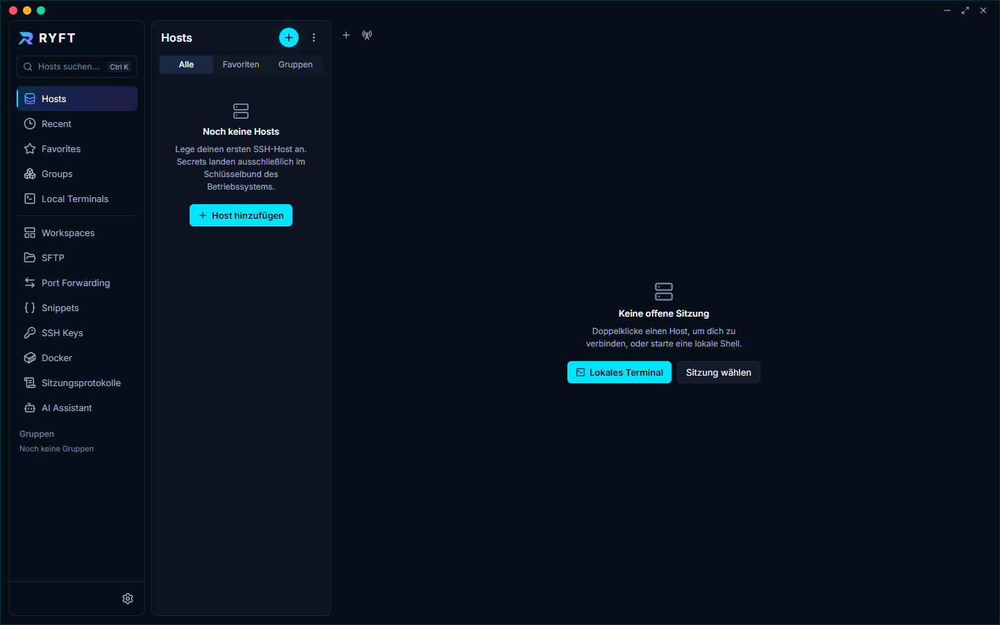

Ohne Hosts lässt RYFT dich nicht vor einer leeren Fläche stehen. Du legst links deinen ersten SSH-Host an oder öffnest rechts direkt ein lokales Terminal. Schon hier steht, wohin Geheimnisse wandern: ausschließlich in den Schlüsselbund des Betriebssystems.

### Host anlegen

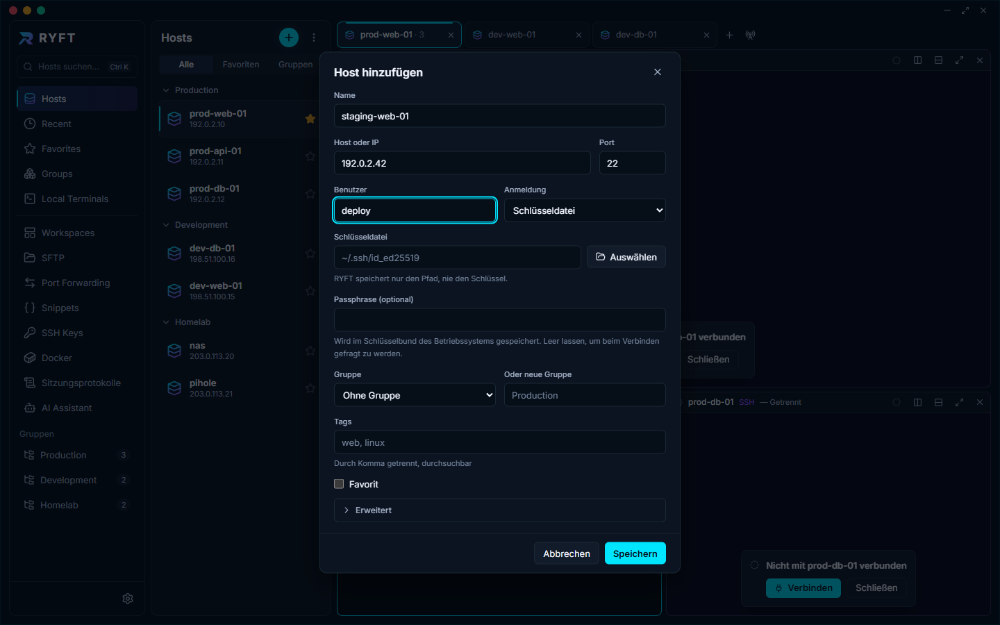

Im Host-Editor trägst du Adresse, Benutzer und Anmeldeart ein und sortierst den Host in eine Gruppe, mit Tags und auf Wunsch als Favorit. Bei einer Schlüsseldatei speichert RYFT nur den Pfad, nie den Schlüssel selbst. Proxy, Keepalive, Sprunghosts und Umgebungsvariablen liegen unter „Erweitert".

### Befehlspalette

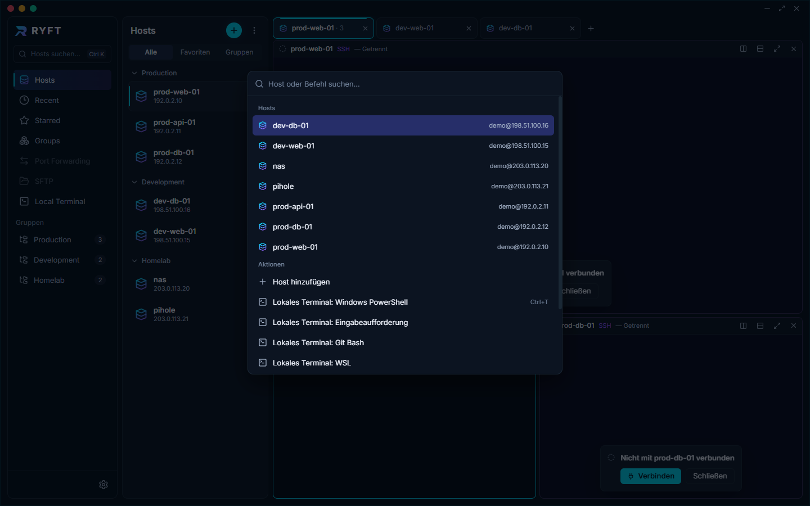

Mit Ctrl+K erreichst du alles über die Tastatur: Hosts samt Benutzer und Adresse, neue Hosts und jede erkannte lokale Shell, von PowerShell über Git Bash bis WSL.

### Verbindungsfehler

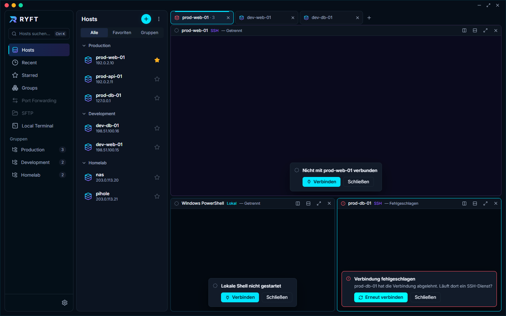

Scheitert eine Verbindung, sagt RYFT direkt im betroffenen Bereich, was passiert ist, und schlägt eine Ursache vor. Mit einem Klick verbindest du erneut, die anderen Bereiche laufen ungestört weiter.

### SFTP

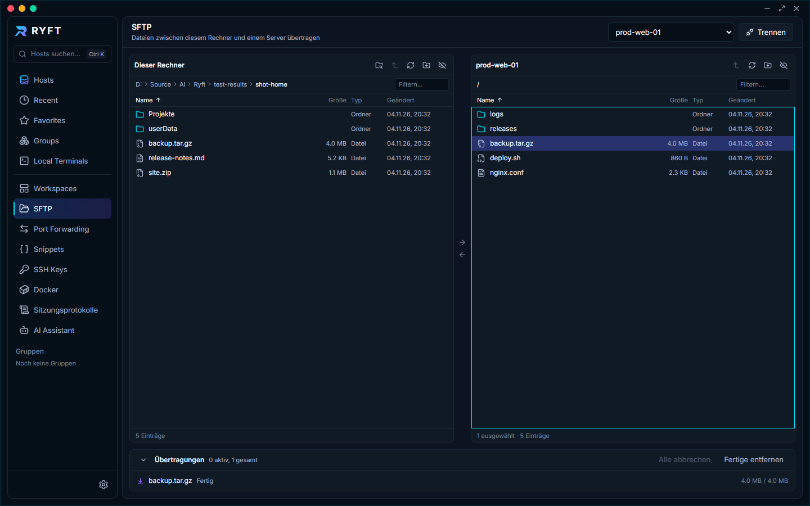

Links liegt dein Rechner, rechts der Server. Dateien verschiebst du per Drag and Drop oder mit den Pfeilen in der Mitte. Unten sammelt die Warteschlange alle Übertragungen mit Fortschritt, und du kannst sie abbrechen oder wiederholen.

### Port Forwarding

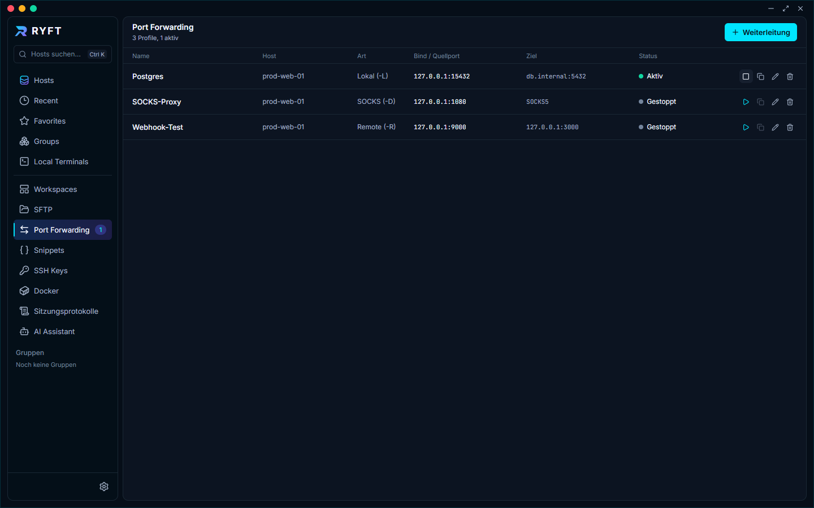

Tunnel speicherst du als Profile: lokal (-L), remote (-R) oder als SOCKS-Proxy (-D). Jedes Profil startest und stoppst du mit einem Klick, und die Zahl in der Navigation zeigt, wie viele gerade aktiv sind.

### Workspaces

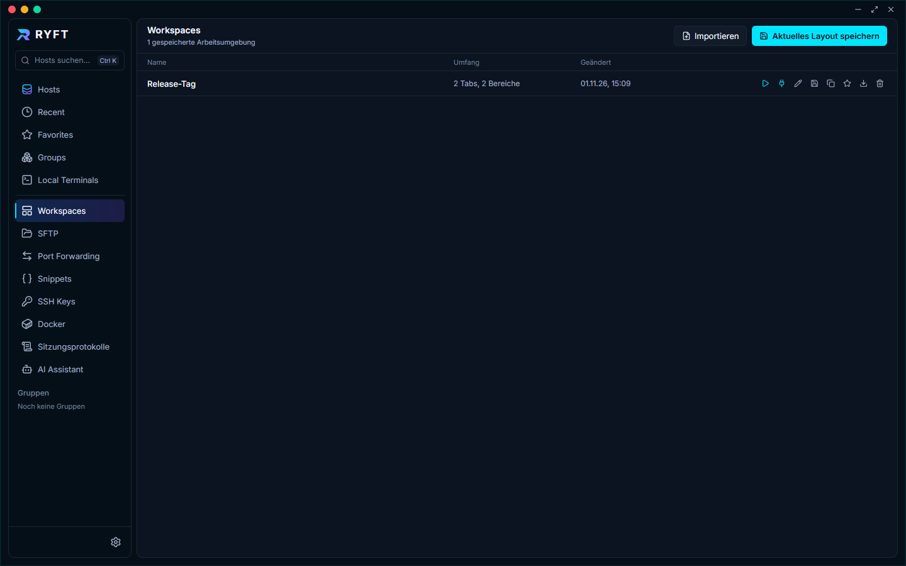

Ein Workspace merkt sich Tabs, geteilte Bereiche und die verbundenen Hosts. So stellst du eine Arbeitsumgebung wie den „Release-Tag" mit einem Klick wieder her. Exportierte Workspaces enthalten keine Geheimnisse und lassen sich weitergeben.

### Snippets

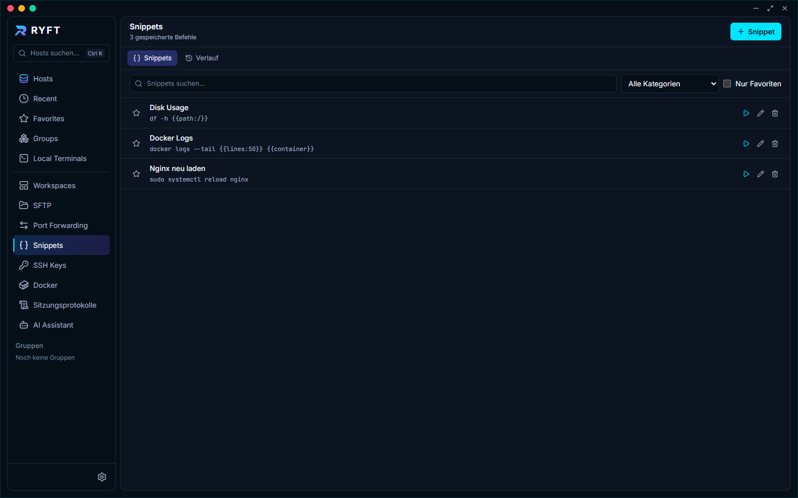

Wiederkehrende Befehle legst du als Snippets ab. Platzhalter wie `{{lines:50}}` werden zu typisierten Parametern mit Vorgabewert, die du vor dem Ausführen ausfüllst. Riskante Befehle wie ein `sudo` markiert RYFT mit einem Warnzeichen.

### Snippet-Bibliothek

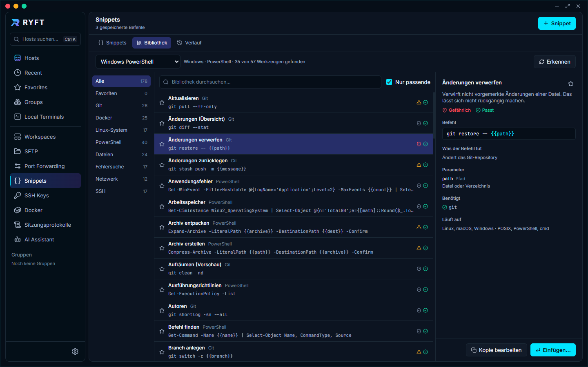

Die mitgelieferte Bibliothek bringt 178 Befehle für Git, Docker, PowerShell, Netzwerk und mehr mit. RYFT prüft, welche Werkzeuge im aktuellen Terminal vorhanden sind, und blendet auf Wunsch nur passende Befehle ein. Rechts erklärt die Vorschau, was ein Befehl tut, was er braucht und wie gefährlich er ist.

### Broadcast

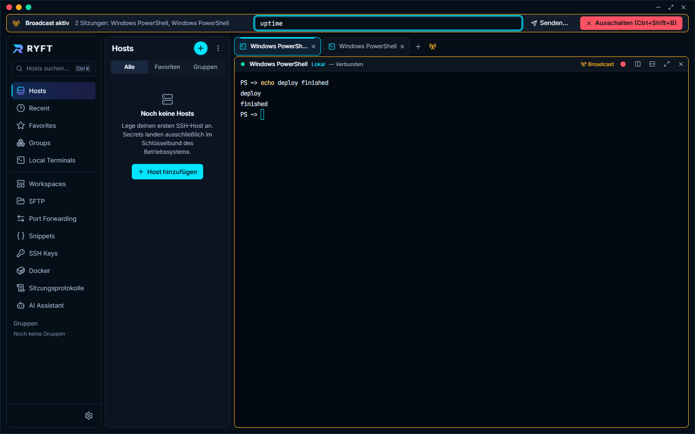

Mit Broadcast tippst du einen Befehl einmal und schickst ihn an mehrere Sitzungen. Solange er aktiv ist, steht oben eine nicht zu übersehende Leiste mit allen Zielen, und Ctrl+Shift+B schaltet ihn sofort ab.

### SSH Keys

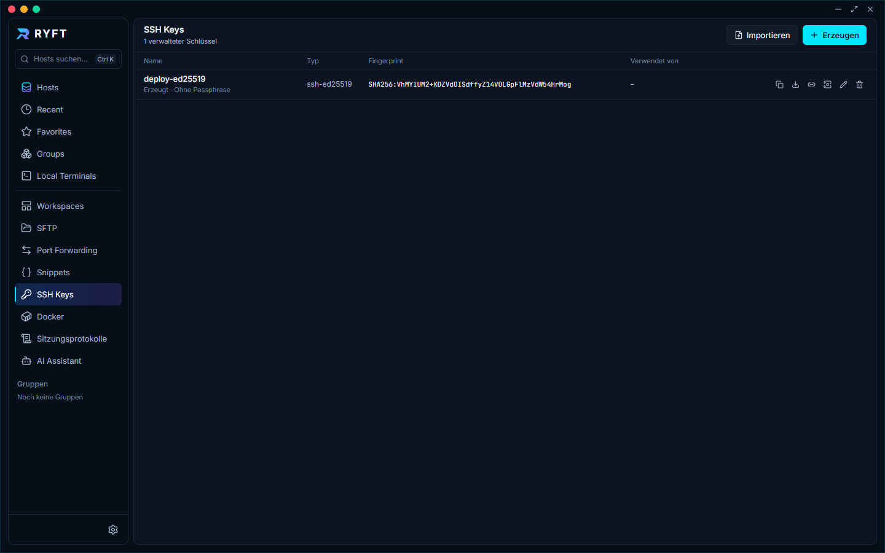

Hier erzeugst oder importierst du ED25519-Schlüssel und siehst ihren Fingerprint. Von hier aus weist du einen Schlüssel Hosts zu oder trägst ihn auf einem Server ein. Den privaten Schlüssel zeigt RYFT nie an.

### Docker

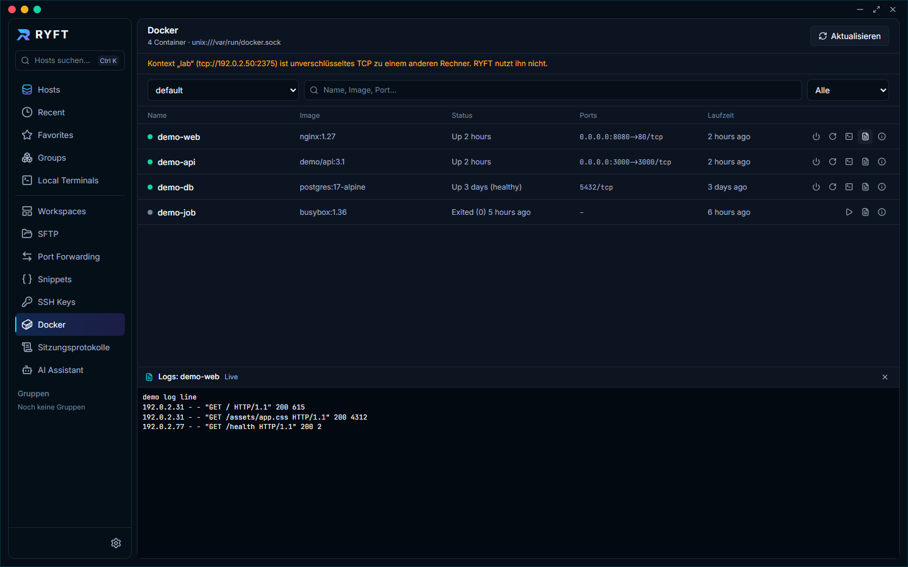

Die Docker-Ansicht listet Container mit Image, Status und Ports. Du startest, stoppst und startest sie neu, öffnest eine Shell darin oder verfolgst unten die Logs live. Unverschlüsselte TCP-Kontexte zu anderen Rechnern erkennt RYFT und nutzt sie bewusst nicht.

### KI-Assistent

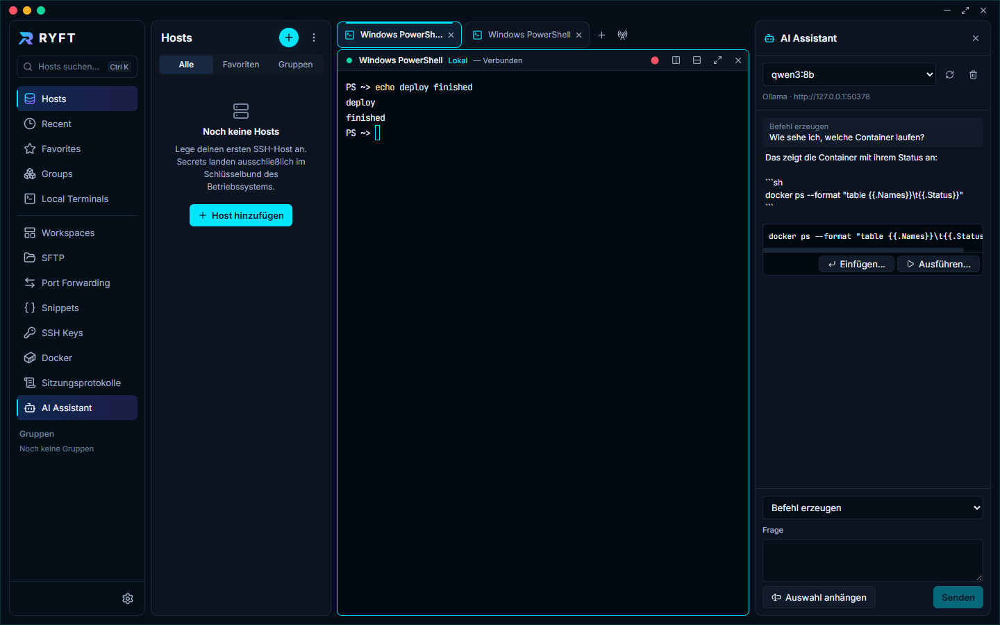

Der Assistent spricht mit einem lokalen Ollama-Modell, deine Daten verlassen den Rechner also nicht. Du fragst in normaler Sprache und bekommst einen Befehl vorgeschlagen. Ausgeführt wird er erst, wenn du den genauen Wortlaut bestätigst.

### Sitzungsprotokolle

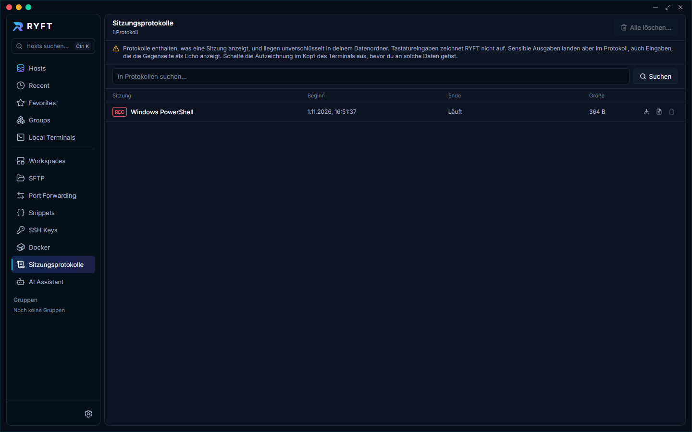

Wenn du die Aufzeichnung einschaltest, landen die Ausgaben einer Sitzung in einem durchsuchbaren Protokoll, das du exportieren kannst. Ein Hinweis erinnert daran, dass Protokolle unverschlüsselt sind und alles enthalten, was das Terminal anzeigt.

### Einstellungen

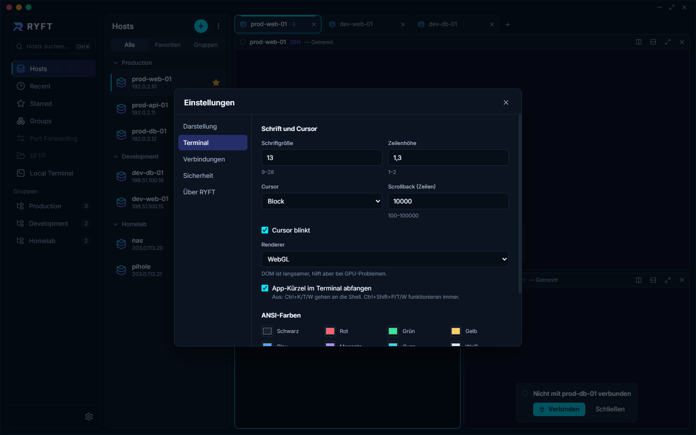

In den Einstellungen passt du Schrift, Cursor, Scrollback und die ANSI-Farben an. Falls die Grafik Probleme macht, schaltest du den Renderer von WebGL auf DOM um. Weitere Seiten regeln Verbindungen, Anmeldeprofile, Befehlsverlauf, WSL, KI-Assistent und Sicherheit.

### Schmales Fenster

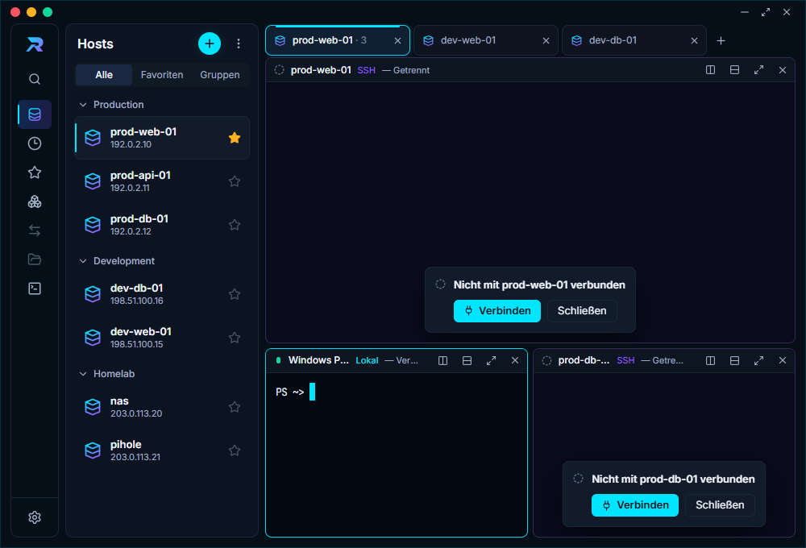

In kleinen Fenstern klappt die Navigation zu einer Symbolleiste ein, damit Hostliste und Terminals genug Platz behalten.

### Woher die Bilder stammen

Die Bilder stammen aus der echten App und werden mit `npm run screenshots` erzeugt. Die Hostnamen sind Beispiele aus den Dokumentations-Adressbereichen. Der Verbindungsfehler entsteht durch einen echten abgelehnten Verbindungsversuch auf 127.0.0.1. Zwei Bilder nutzen Testdaten: Die Docker-Ansicht zeigt Demo-Container aus `e2e/dockerStub.ts`, der KI-Assistent spricht mit einem lokalen Testserver statt mit einem echten Modell.

## Installation

Installer stehen unter [Releases](https://github.com/naice/ryft/releases/latest). Jeder Push auf `main` erzeugt ein neues Release.

| Plattform | Datei |
| --- | --- |
| Windows x64 | `RYFT.Setup.<Version>.exe` |
| macOS Apple Silicon | `RYFT-<Version>-arm64.dmg` |
| Linux x64 | `RYFT-<Version>.AppImage` oder `ryft_<Version>_amd64.deb` |

Die Programme sind nicht signiert, Windows SmartScreen und macOS Gatekeeper warnen also beim ersten Start. Automatische Updates gibt es nicht.

## Entwicklung

Voraussetzung ist Node.js 24 oder neuer. Auf Windows und macOS ist kein C++-Compiler nötig, weil node-pty vorkompiliert mitkommt. Auf Linux kompiliert `npm install` node-pty und braucht dafür Compiler und Python.

```sh
git clone https://github.com/naice/ryft.git
cd ryft
npm install
npm run dev
```

| Befehl | Zweck |
| --- | --- |
| `npm run dev` | Entwicklung mit Hot Reload |
| `npm run build` | Produktions-Build nach `out/` |
| `npm run typecheck` | TypeScript prüfen |
| `npm run lint` | ESLint |
| `npm test` | Unit- und Integrationstests |
| `npm run test:e2e` | Build und E2E-Tests der echten App |
| `npm run screenshots` | Build und Screenshots nach `docs/screenshots/` |
| `npm run check:docs` | Bildverweise der README prüfen |
| `npm run package:dir` | Ungepacktes Programm nach `release/` |
| `npm run package` | Installer für die aktuelle Plattform nach `release/` |

Den Test des gepackten Programms startest du nach `npm run package:dir` mit `npx playwright test --project=packaged`.

Die Standardtests verwenden nie echte Hosts. `tests/fixtures/sshServer.ts` ist ein SSH-Server im Testprozess auf 127.0.0.1 mit echten Handshakes. Die E2E-Tests laufen mit einem temporären Profil und eigenem `HOME`, damit deine Schlüssel und `known_hosts` außen vor bleiben.

Tests gegen echte Dienste laufen nur, wenn du die passende Umgebungsvariable setzt. Richte sie nur auf Umgebungen, die du entbehren kannst:

| Variable | Test |
| --- | --- |
| `RYFT_TEST_OPENSSH=<Host>:<Port>:<Benutzer>:<Schlüssel>:<Ordner>` | `tests/real` gegen einen Wegwerf-sshd, den zum Beispiel `tests/fixtures/wsl-openssh.sh` startet |
| `RYFT_TEST_WSL=<Distribution>` | WSL-Tests |
| `RYFT_TEST_DOCKER_WSL=<Distribution>`, `RYFT_TEST_DOCKER_IMAGE=<Image>` | Docker-Tests mit einem eigenen, markierten Container |
| `RYFT_TEST_OLLAMA_URL=<Adresse>` | Ollama: Modellliste und eine sofort abgebrochene Anfrage |

## Tastaturkürzel

Auf macOS steht Cmd anstelle von Ctrl. Ausnahme: Der Tab-Wechsel nutzt überall Ctrl+Tab.

| Kürzel | Aktion |
| --- | --- |
| Ctrl+K oder Ctrl+Shift+P | Befehlspalette |
| Ctrl+T oder Ctrl+Shift+T | Lokales Terminal |
| Ctrl+W oder Ctrl+Shift+W | Tab schließen |
| Ctrl+Shift+D / Ctrl+Shift+E | Rechts / unten teilen |
| Ctrl+Tab / Ctrl+Shift+Tab | Nächster / vorheriger Tab |
| Ctrl+Alt+Pfeiltasten | Bereich wechseln |
| Ctrl+Shift+Space | Vorschläge aus Verlauf und Snippets |
| Ctrl+Shift+B | Broadcast starten oder sofort beenden |

**Konflikt mit der Shell:** Ctrl+K, Ctrl+T und Ctrl+W haben in vielen Shells eine eigene Bedeutung. Wenn du sie dort brauchst, schalte unter Einstellungen → Terminal „App-Kürzel im Terminal abfangen" aus. Die Shift-Varianten funktionieren immer.

**Zwischenablage im Terminal:**

- Windows: Ctrl+C kopiert nur bei aktiver Auswahl und sendet sonst SIGINT; Ctrl+V fügt ein.
- Linux: Ctrl+Shift+C und Ctrl+Shift+V.
- macOS: Cmd+C und Cmd+V.

## Sicherheitsmodell

- **Renderer gilt als nicht vertrauenswürdig:** `contextIsolation` an, `nodeIntegration` aus, schmale typisierte Preload-Brücke, Validierung aller IPC-Eingaben mit zod im Hauptprozess und eine strikte CSP.
- **Secrets:** Passwörter und Passphrasen werden nur auf Wunsch gespeichert und mit Electron `safeStorage` verschlüsselt (DPAPI, Keychain, libsecret/kwallet). Bietet Linux keinen echten Schlüsselbund (`basic_text`), speichert RYFT nichts und fragt stattdessen bei jeder Verbindung nach.
- **Schlüssel:** In SQLite steht nur der Pfad zur Schlüsseldatei, nie ihr Inhalt. Private Schlüssel werden nicht angezeigt und nie überschrieben.
- **Host-Keys:** Die Prüfung lässt sich nicht abschalten und gilt für jede Station einer Sprunghost-Kette einzeln. `~/.ssh/known_hosts` wird nur gelesen, eigene Vertrauensentscheidungen liegen in der App-Datenbank.
- **Sitzungen:** Sie laufen im Hauptprozess und enden, wenn der Renderer neu lädt oder abstürzt. Beim Start verbindet RYFT nur Tunnelprofile, bei denen du das Wiederherstellen eingeschaltet hast.
- **Workspaces:** Gespeicherte Startbefehle laufen erst, wenn du das in den Einstellungen erlaubst. Exporte enthalten keine Geheimnisse.
- **KI-Assistent:** Ab Werk aus und nur mit lokalen oder privaten Adressen nutzbar. Das Modell erhält nur Text, den du schreibst oder ausdrücklich anhängst. Seine Antworten gelten als nicht vertrauenswürdig, und Befehle laufen erst nach deiner Bestätigung des genauen Wortlauts.
- **Docker:** Befehle laufen als Argumentlisten mit geprüften Bezeichnern. Unverschlüsselte TCP-Kontexte zu anderen Rechnern nutzt RYFT nicht.
- **Sitzungsprotokolle:** Ab Werk aus und ohne Tastatureingaben. Sie liegen unverschlüsselt im Datenordner und können Geheimnisse enthalten, die eine Sitzung ausgibt oder als Echo zeigt. Auch der Befehlsverlauf ist unverschlüsselt.
- **Broadcast:** Ziele wählst du ausdrücklich, und neue Sitzungen kommen nie von selbst dazu.

Die Details stehen in [docs/ARCHITECTURE.md](docs/ARCHITECTURE.md). Schwachstellen meldest du wie in [SECURITY.md](SECURITY.md) beschrieben.

## Fehlerbehebung

**`MODULE_NOT_FOUND 'electron'` oder die App startet als reines Node:** Die Umgebungsvariable `ELECTRON_RUN_AS_NODE=1` ist gesetzt, was in VS-Code-Terminals vorkommt. Abhilfe: `unset ELECTRON_RUN_AS_NODE` (PowerShell: `Remove-Item Env:ELECTRON_RUN_AS_NODE`).

**„Kein SSH-Agent gefunden":** RYFT nutzt `SSH_AUTH_SOCK`, auf Windows sonst die Pipe von OpenSSH oder Pageant. Der Windows-Dienst `ssh-agent` ist ab Werk oft deaktiviert und muss erst aktiviert und gestartet werden.

**Gespeichertes Passwort wird nach dem Neustart erneut abgefragt:** Das kam in automatischen Tests selten vor, wenn die allererste Sitzung eines Profils nach wenigen Sekunden beendet wurde. Die Ursache ist noch nicht geklärt. Es geht dabei nichts verloren außer der gespeicherten Eingabe: Gib das Passwort erneut ein und speichere es wieder.

**Terminal bleibt leer oder flackert:** Stelle unter Einstellungen → Terminal den Renderer von WebGL auf DOM um.

**`AttachConsole failed` in der Testausgabe:** Diese Meldung stammt von einem Hilfsprozess von node-pty unter Windows, wenn eine Test-Shell beendet wird. Sie beeinflusst das Testergebnis nicht.

## Plattformen

| Plattform | Stand |
| --- | --- |
| Windows 11 x64 | Entwickelt und getestet: Unit-, Integrations- und E2E-Tests, gepacktes Programm |
| macOS Apple Silicon | Nur automatischer Starttest des gepackten Programms in GitHub Actions |
| Linux x64 | Nur automatischer Starttest des gepackten Programms in GitHub Actions |

SSH, SFTP, Tunnel und Sprunghosts liefen von Windows aus gegen einen echten OpenSSH-Server in WSL. Docker, WSL und Ollama liefen unter Windows gegen echte Installationen. Die Docker-Oberfläche selbst wird in den E2E-Tests mit Demodaten geprüft.

**Nicht getestet:** ein echter System-Agent, das Eintragen eines Schlüssels auf einem echten OpenSSH-Server, der Befehlsverlauf für zsh sowie alle Funktionen unter Linux und macOS außer dem Starttest. Docker und WSL prüft RYFT zur Laufzeit und zeigt sie als nicht verfügbar an, wenn sie fehlen.

## Aufbau

```
src/main       Hauptprozess: SQLite, Secrets, SSH, SFTP, Tunnel, PTY, Docker, WSL, KI, Protokolle, IPC
src/preload    Typisierte Brücke zum Renderer
src/renderer   React-Oberfläche
src/shared     Verträge und Zustandsmodell für beide Seiten
tests          Unit-, Integrationstests, Tests gegen echte Dienste und Fixtures
e2e            Playwright gegen die echte App
scripts        Pre-Push-Prüfung der Dokumentation
reference      Designkit und visuelle Referenz
docs           Handbuch, Architektur, Changelog, Release Notes, Fortschritt, Screenshots
```

Designwerte stehen als Tokens in `src/renderer/src/styles/themes.css`. Komponenten enthalten keine Farbwerte, das prüft ein Unit-Test. Einzige Ausnahme ist die Datei `terminalTheme.ts`, weil xterm konkrete Farben braucht.

Gebaut mit Electron, React, TypeScript, Tailwind, xterm.js, ssh2 und node-pty.

## Mitarbeit

Wie du mitarbeitest und warum vor jedem Push README und Screenshots aktuell sein müssen, steht in [CONTRIBUTING.md](CONTRIBUTING.md).

## Lizenz

RYFT steht unter der [PolyForm Noncommercial License 1.0.0](LICENSE). Für nicht kommerzielle Zwecke darfst du den Code frei nutzen, verändern und weitergeben, etwa privat, zum Lernen, für Forschung oder in gemeinnützigen Organisationen. Der Lizenztext und der Copyright-Hinweis müssen dabei erhalten bleiben. Die Software kommt ohne jede Gewährleistung.

Jede kommerzielle Nutzung braucht eine gesonderte schriftliche Erlaubnis des Rechteinhabers. Wer RYFT kommerziell einsetzen möchte, fragt über ein [Issue](https://github.com/naice/ryft/issues) an.

RYFT ist damit quelloffen einsehbar, aber keine Open-Source-Software im Sinne der OSI.

„RYFT" ist ein Arbeitstitel und nicht markenrechtlich geprüft.
